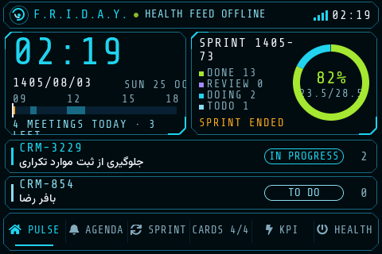
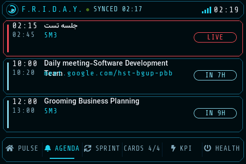
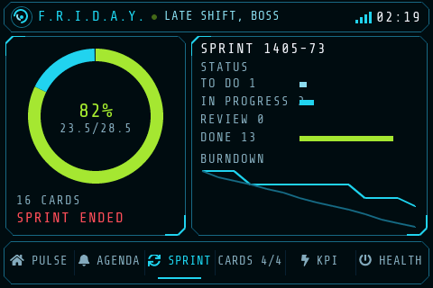
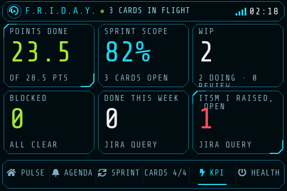

<p align="center">
  
</p>

<p align="center">
  
  
  
  
</p>

<p align="center"><code>&gt; BOOT SEQUENCE … WIFI LINKED … JIRA SYNCED … CALENDAR SYNCED … KUMA ONLINE … READY, BOSS_</code></p>

**F.R.I.D.A.Y.** is a standalone desk display: an ESP32 and a 3.5" TFT showing your Jira sprint, your cards and KPIs, today's meetings, and the health of your services from Uptime Kuma, in an Iron Man style heads-up display. It joins WiFi and talks to Jira, Exchange and Kuma directly. No PC, no server.

## ◢ Screens

<table>
  <tr>
    <td width="50%"><br><b>PULSE</b> — clock, Jalali and Gregorian date, today's meeting timeline, sprint ring, and the cards you're working on.</td>
    <td width="50%"><br><b>AGENDA</b> — the next meetings with room or Meet link, a LIVE tag on the one running and a countdown on the rest.</td>
  </tr>
  <tr>
    <td><br><b>SPRINT</b> — points-done gauge, cards per status, and a burndown (actual vs ideal).</td>
    <td><br><b>KPI</b> — points done, scope, WIP, blocked, and two tiles you define with JQL.</td>
  </tr>
</table>

Also: **CARDS** (every sprint card, tinted by status, paged) and **HEALTH** (one tile per Kuma monitor with ping and 24 h uptime). Screens rotate on their own; the timing is on the settings page.

> Screenshots come straight from the board: `http://jira-status.local/screenshot`.

### ◢ Alerts

A banner slides over every screen:

| Signal | When | Shows |
|---|---|---|
| 🔔 `NEXT MEETING` · amber | 5 min before a meeting | title, room / link, countdown |
| ▶ `MEETING LIVE` · pulsing | first 2 min of a meeting | title, room / link, time since start |
| ⚠ `SERVICE DOWN` · pulsing | a Kuma monitor is down | names, down / total |

Several at once rotate every 4 s with a `1/2` counter. The header line changes with them: `GOOD MORNING, BOSS`, `YOU'RE LIVE, BOSS`, `1 SERVICE(S) DOWN, BOSS`.

## ◢ Presence status

Tell colleagues at your desk where you are. Your bot (or any script) writes your status to a hidden Jira **user property** on your own account; the board checks it every minute. While a status is set, the board shows a full-screen animated status card that alternates with the Kuma health screen. The tab bar and meeting banners are hidden; outage alerts still show.

| `status` | Screen | Animation | Clears itself |
|---|---|---|---|
| `WFH` | WORKING FROM HOME | radar sweep with blips, signal bars, `UPLINK ACTIVE` | no — until changed |
| `ON_THE_WAY` | ON MY WAY · big ETA · `ARRIVING IN 12 MIN` | route from HOME to HQ; the dot moves with real progress toward the ETA, HQ flashes on arrival | 2 h after the ETA (4 h after it was set without one) |
| `LEFT` | LEFT THE OFFICE · `BACK AT 09:00` | shutdown sequence, then standby blink with a scan line | at `eta`, else 06:00 next morning |
| `AWAY` | NOT AVAILABLE · `DO NOT DISTURB` | red shield with lights chasing its edge, hazard tape | at `eta`, else no |
| `IN` or no property | normal dashboard | – | – |

Every change types the title in with a short boot flicker. The status screen exists only while a status is set, so it costs no RAM at the office.

**API** — your own account, read access token is enough (no admin needed):

```
PUT    $JIRA/rest/api/2/user/properties/friday.status?username=$USER
DELETE $JIRA/rest/api/2/user/properties/friday.status?username=$USER   (back to normal)
GET    $JIRA/rest/api/2/user/properties/friday.status?username=$USER   (404 = no status)
Headers: Authorization: Bearer $PAT, Content-Type: application/json
Body:    {"status": "...", "eta": "HH:MM", "note": "..."}
```

- `eta` (optional, 24 h local time): arrival for `ON_THE_WAY`, "back at" for `LEFT` / `AWAY`.
- `note` (optional, up to 120 characters, Persian works).
- Aliases: `HOME`/`REMOTE`, `OTW`/`COMING`, `OUT`/`GONE`, `NOT_AVAILABLE`/`UNAVAILABLE`; case, spaces and dashes don't matter.
- Your username is the `name` from `GET $JIRA/rest/api/2/myself`.

```bash
# working from home
curl -X PUT -H "Authorization: Bearer $PAT" -H "Content-Type: application/json" -d '{"status":"WFH","note":"Available on Teams"}' "$JIRA/rest/api/2/user/properties/friday.status?username=$USER"
# on the way, arriving 09:40
curl -X PUT -H "Authorization: Bearer $PAT" -H "Content-Type: application/json" -d '{"status":"ON_THE_WAY","eta":"09:40"}' "$JIRA/rest/api/2/user/properties/friday.status?username=$USER"
# left, back at 09:00
curl -X PUT -H "Authorization: Bearer $PAT" -H "Content-Type: application/json" -d '{"status":"LEFT","eta":"09:00"}' "$JIRA/rest/api/2/user/properties/friday.status?username=$USER"
# not available until 14:00
curl -X PUT -H "Authorization: Bearer $PAT" -H "Content-Type: application/json" -d '{"status":"AWAY","eta":"14:00","note":"In a client meeting"}' "$JIRA/rest/api/2/user/properties/friday.status?username=$USER"
# back at the office
curl -X DELETE -H "Authorization: Bearer $PAT" "$JIRA/rest/api/2/user/properties/friday.status?username=$USER"
```

Suggested bot commands: `/wfh [note]`, `/otw 09:40 [note]`, `/left [09:00]`, `/away [14:00] [note]`, `/in`, `/status`.

### ◢ Room sound level (MAX4466)

A MAX4466 microphone measures the room all the time (on the second CPU core, so the screen never waits for it). The header shows a speaker icon in the stage's color, and the status line rotates in `ROOM: NORMAL · 52 DB`.

| Stage | Level | Color |
|---|---|---|
| **FOCUS** | below 45 dB | lime |
| **NORMAL** | 45-58 dB | cyan |
| **DISTRACTING** | 58-70 dB | amber |
| **TOO LOUD** | above 70 dB | red |

The level is smoothed over about 5 seconds (a door slam doesn't count), and a stage only changes 2 dB past its limit. Wiring: **VCC → 3V3, GND → GND, OUT → GPIO 1** (an ADC1 pin; ADC2 pins don't work while WiFi is on). The numbers are approximate: set **Microphone calibration** on the settings page so that a quiet room reads about 35-40 dB, and turn the gain screw on the MAX4466 to the middle. Limits and the pin are in `config.h`; `MIC_ENABLED 0` turns it off.

### ◢ Badge reader (RC522)

Tap your badge on the reader next to the board when you arrive and when you leave: it flips your status between `IN` (normal dashboard) and `LEFT` (with its usual 06:00 expiry), through the same Jira property. The header confirms with `WELCOME BACK` / `SEE YOU`; the screen changes at once and the write to Jira follows within seconds (retried until it goes through).

| RC522 | ESP32-S3 |
|---|---|
| SDA (SS) | GPIO 15 |
| SCK | GPIO 5 |
| MOSI | GPIO 6 |
| MISO | GPIO 7 |
| RST | GPIO 16 |
| 3.3V / GND | 3V3 / GND |

Install the library **MFRC522** (by GithubCommunity). Tap an unknown badge once: the header shows `UNKNOWN BADGE 04A1B2C3`; put that id in **Badge ids** on the settings page (several ids: comma separated). Pins are in `config.h`; `RFID_ENABLED 0` turns it off.

## ◢ Systems

```
┌─ JIRA ───────────┐  ┌─ CALENDAR ───────────┐  ┌─ KUMA ───────────┐
│ sprint, cards,   │  │ Exchange ICS link    │  │ public status    │
│ burndown, JQL    │  │ repeating meetings   │  │ page, ping and   │
│ KPIs (PAT auth)  │  │ (RRULE / EXDATE /    │  │ 24 h uptime      │
│                  │  │ moved / cancelled)   │  │ every minute     │
└────────┬─────────┘  └──────────┬───────────┘  └────────┬─────────┘
         └───────────── HTTPS, every 15 min ─────────────┘
                                 │
                   ┌─────────────▼─────────────┐
                   │  ESP32 · LVGL 9 · 480×320 │
                   └───────────────────────────┘
```

- **Calendar:** reads the whole published `.ics`, expands repeating meetings for today (daily / weekly, interval, by-day, until, count), drops deleted occurrences and applies moved or cancelled ones. On the office network it falls back to the internal mail server when the public address is refused. It refreshes every 15 minutes, on boot and at midnight.
- **Meeting place:** a room code like `5M3` or `BM4` from the location, title or description; otherwise a Google Meet or Skyroom link; otherwise the location text.
- **Network:** saved WiFi first, then company WiFi (WPA2-Enterprise / PEAP), then its own setup hotspot. Time comes from the company domain controller, then public NTP.
- **Memory:** every feature has a memory budget that is checked when you compile, measured on the board and checked again before it runs, so the board frees the screen, postpones or restarts instead of running out (see [docs/MEMORY.md](docs/MEMORY.md) and `/memory`). Only the page on screen exists; the screen library has its own pool, kept out of the big heap region HTTPS needs. The board also restarts itself every night at 04:00.

## ◢ Hardware

| Part | Notes |
|---|---|
| ESP32 dev board | ESP32-WROOM-32, 4 MB flash. No PSRAM needed (a WROVER with PSRAM gives more headroom). |
| 3.5" SPI TFT, 320×480 | ILI9488 / ST7796 via TFT_eSPI. Pins: `SDA` `SCL` `CS` `DC` `RES` `BLK`. No MISO needed. |

## ◢ Build

1. **Board:** ESP32 Arduino core 3.x → **ESP32 Dev Module**.
2. **Partition scheme:** **Minimal SPIFFS (1.9MB APP with OTA)**.
3. **Libraries:** `lvgl` **9.2.x**, `TFT_eSPI`, `WiFiManager` (tzapu), `ArduinoJson` **7.x**.
4. **LVGL config:** copy `extras/lv_conf.h` to `Documents/Arduino/libraries/lv_conf.h`, next to the `lvgl` folder. Copy it again after updates; an old copy stops the build with a clear message.
5. **Screen:** set your panel and pins in TFT_eSPI's `User_Setup.h`.
6. **Upload** `jira_status/jira_status.ino`.

USB is needed **once**. After that, update over WiFi:

- **Browser:** *Sketch → Export compiled binary*, then upload `jira_status.ino.bin` as **Firmware** at `http://jira-status.local/update`.
- **Arduino IDE:** pick the network port `jira-status`.

## ◢ First run

1. Join the WiFi **Jira-Status-Setup** that the screen shows and pick your network.
2. The screen shows the settings URL and password. User `admin`; the default password is the last 6 hex digits of the chip ID.
3. Until Jira is set up the board shows demo data.
4. On the settings page fill in:
   - **Jira URL** and **Personal access token** (Jira profile → Personal Access Tokens, read access is enough).
   - **Story points field**, e.g. `customfield_10006`.
   - **Board ID** from the board URL (`rapidView=…`), for the sprint name and end date.
   - **Calendar .ics URL**: Outlook on the web → Settings → Calendar → Shared calendars → Publish a calendar → ICS link.
   - **Company WiFi** (optional): SSID, user and password for PEAP.
   - **Backup URLs** (optional) for Jira, Kuma and the calendar: tried when the first address fails (for example a relay PC at home that reaches the company network over VPN). The address that worked is tried first next time.

## ◢ Web console

| Path | Does |
|---|---|
| `/` | settings |
| `/refresh` | fetch everything now |
| `/memory` | memory budget: estimate vs measured per feature, room right now |
| `/screenshot` | the screen as a 480×320 BMP (redrawn once and streamed, no extra RAM) |
| `/update` | firmware upload |

All pages use the `admin` login.

## ◢ Secrets

The token and passwords live **only in the board's flash (NVS)**. They are never in this repo, and the settings page never sends the token back to the browser. The published calendar link is private too: anyone who has it can read your calendar.

## ◢ Known limits

- **Recurring meetings:** daily and weekly rules are expanded; monthly and yearly ones are skipped.
- **Persian text:** card titles use Vazirmatn (14, 16 and 20 px) with Montserrat for icons. The big numbers stay Latin only. To change sizes or ranges, edit and run `extras/make_fonts.sh` (needs Node).
- **Certificates:** HTTPS certificates aren't checked (`setInsecure`), because internal services often use a private CA.
- **Memory:** a 4 MB ESP32 without PSRAM is tight for HTTPS plus a full-screen UI. The board recovers by restarting when it runs out; a WROVER removes the limit.

<p align="center"><sub>F.R.I.D.A.Y. 1.0.0 · <code>[ SYSTEMS ONLINE ]</code></sub></p>
